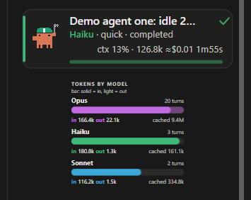

# mission-control

A Claude Code mod that shows live status for your session: which model is working, which helper agents are running, and where the tokens go.



## What you get

- **A band above the prompt** with a **◉ Control** button and an animated orbit while work is running.
- **A side pane** (open it with the button or a command):
  - **Crab cards** for each running helper agent: context %, approximate cost, elapsed time and a sweep bar. Each crab wears a costume by agent type (built-in types and a few common names have one; anything else gets a generic costume).
  - **Tokens by model**: stacked bars for fresh input (solid), output (mid) and cached (light).
  - **Hand-offs** between models.

## Commands

| Command | Opens |
|---|---|
| `/control` | Mission control pane |
| `/models` | Same pane, for models and tokens |
| `/agentinfo` | Same pane, for helper agents |
| `/live` | Same pane, for live status |

## Install

```
/plugin marketplace add <owner>/mission-control
/plugin install mission-control@mission-control
```

Chats that are already open need a restart before they pick it up.

## Notes

- **Cost is an estimate.** It uses a built-in price table (USD per million tokens) applied to the token counts Claude Code reports. Check your real bill for exact numbers.
- Prices and model names live at the top of `hooks/register.tsx`; edit them to suit.

## Credits and license

The pixel crab art is ported from [savvy-progress](https://github.com/JohnnyVizz/claude-kit) by johnnyvizz (MIT, Copyright (c) 2026 johnnyvizz); see `hooks/crabs.ts`.

Released under the [MIT License](LICENSE).

## Optional: model-routing kit

Mission control shines when work is split across cheap and strong models. `extras/` has the setup it was built with:

- `extras/agents/`: four agents. `planner` (Opus) plans, `builder` (Sonnet) implements, `quick` (Haiku) does mechanical jobs and `bug-hunter` (Opus) takes hard bugs. Each wears its own crab costume in the pane. Copy them to `~/.claude/agents/`.
- `extras/CLAUDE.md`: a routing section that tells Claude when to use each one. Paste it into `~/.claude/CLAUDE.md`.
